<div align="center">


# AtithiHQ

**A guest book that fills itself.**

Bookings, guest details, payments and GST invoices for homestay, villa and guest house owners in India.
Send one WhatsApp link per booking, and guests add their own details before they arrive.


[Features](#features) · [Screenshots](#screenshots) · [Try it](#try-it-locally) · [Tech](#tech-stack) ·
[Architecture](#architecture) · [Roadmap](#roadmap)

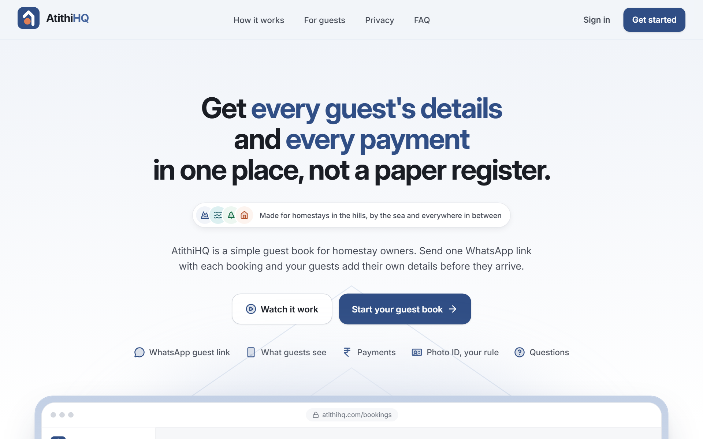

</div>

---

## Why AtithiHQ

Most small stays in India still keep a paper register. The owner copies names and ID numbers at the door,
tracks who has paid in a notebook, and writes bills by hand. AtithiHQ replaces that with one simple flow:

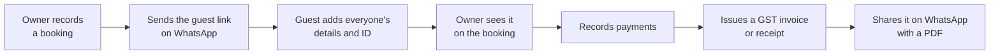

No app for the guest to install, no login for them, and no room numbers to manage. Just the booking,
the people staying, and the money.

> [!NOTE]
> **UI phase.** The full product UI is built and tested. There is no backend yet: all data comes from a mock
> API (`src/lib/mock`) that behaves like the real one and is saved in your browser's localStorage. Links
> therefore work in any tab of the same browser, but not on another device until the backend is connected
> ([how](#connecting-the-real-backend)).

## Features

| Feature                       | What it does                                                                                                                                                   |
| ----------------------------- | -------------------------------------------------------------------------------------------------------------------------------------------------------------- |
| **Today at a glance**         | Arriving, staying and leaving today, guests awaiting details and money outstanding, with Today / Upcoming / Past tabs, filters and export.                     |
| **Room inventory**            | Rent the entire property, room by room, or both. Rooms are counted, never numbered, and the booking form shows what is free so nothing is double-booked.       |
| **WhatsApp guest link**       | One link per booking. The person who booked fills in everyone staying in about two minutes. No login, no app, works on any phone.                              |
| **Private by design**         | Only the last 4 digits of an ID are kept, Aadhaar numbers are masked on the guest's phone, ID photos are deleted automatically, and ID data is never exported. |
| **Payments**                  | Total, received and due for every booking, with overdue stays called out and payments recorded right from the list.                                            |
| **GST invoices and receipts** | Tax invoices with the owner's GSTIN, GST at 5, 12 or 18% included or added on top, and numbering per financial year (`SV/TI/2026-27/0001`).                    |
| **Corrections, done right**   | Issued documents are locked snapshots. Mistakes are fixed by issuing a new version with a reason, and the earlier version stays on record.                     |
| **Share and download**        | Send the invoice on WhatsApp as a private link that expires in 48 hours. Guests and owners download an A4 PDF made in the browser.                             |
| **Guest directory**           | Every guest, grouped by booking, with search, returning guests marked and export to Excel or CSV.                                                              |
| **Built for phones first**    | Bottom tabs on phones, a rail on tablets and a sidebar on desktop. Screens pass an axe WCAG 2.1 AA audit, and touch targets are at least 44px.                 |

## Screenshots

### Owner app

<table>
  <tr>
    <td width="50%">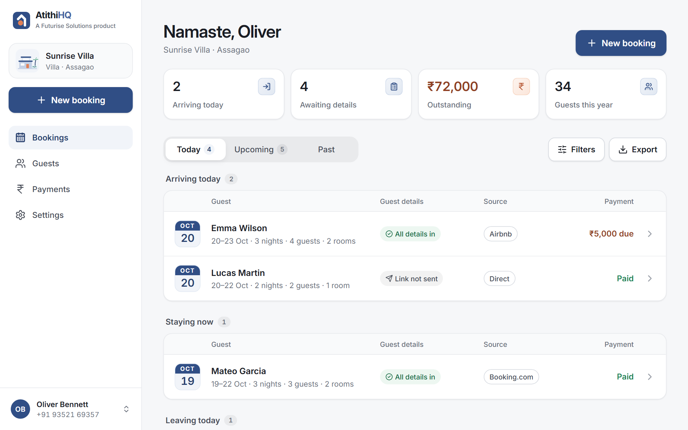<br/><sub><b>Bookings</b> — today's arrivals, stays and departures</sub></td>
    <td width="50%">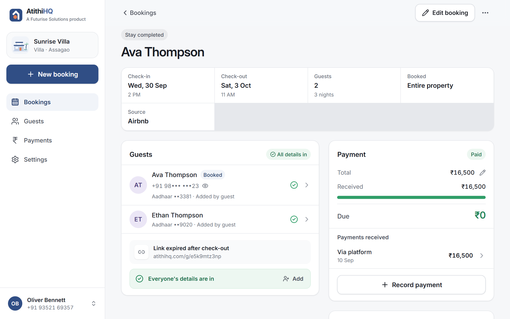<br/><sub><b>Booking</b> — guests, ID status and payments together</sub></td>
  </tr>
  <tr>
    <td>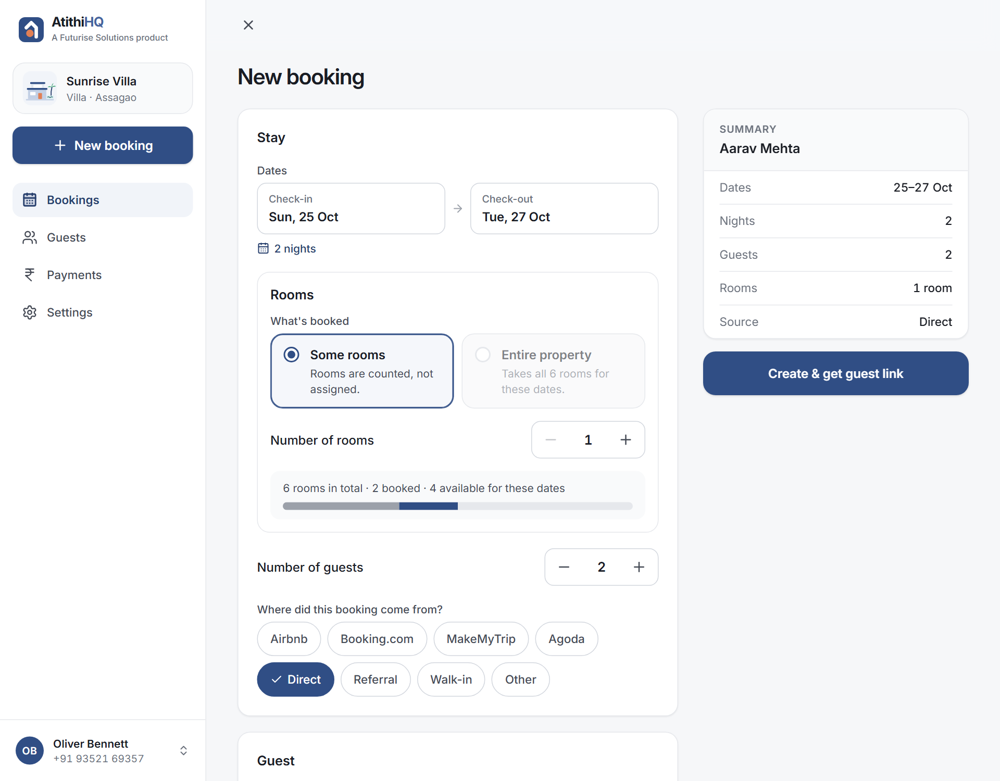<br/><sub><b>New booking</b> — live room availability for the chosen dates</sub></td>
    <td>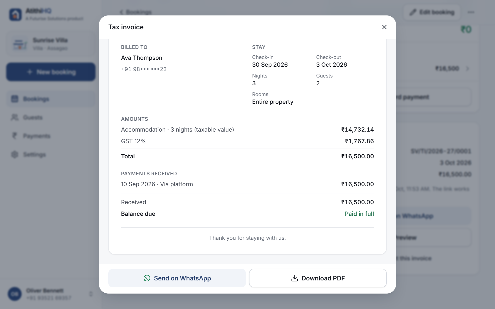<br/><sub><b>Tax invoice</b> — GST worked out, ready to send or download</sub></td>
  </tr>
  <tr>
    <td>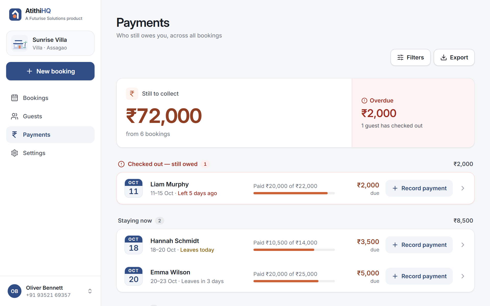<br/><sub><b>Payments</b> — who still owes you, overdue first</sub></td>
    <td>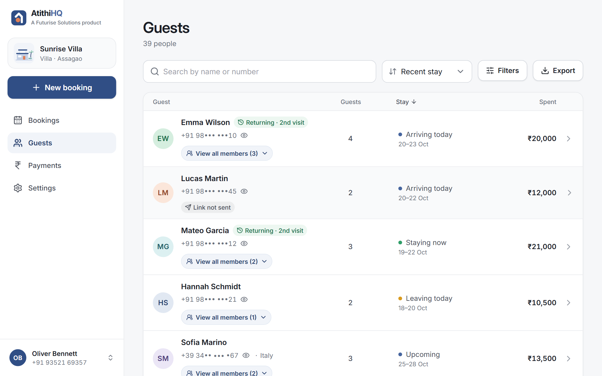<br/><sub><b>Guests</b> — every guest, returning visitors marked</sub></td>
  </tr>
  <tr>
    <td>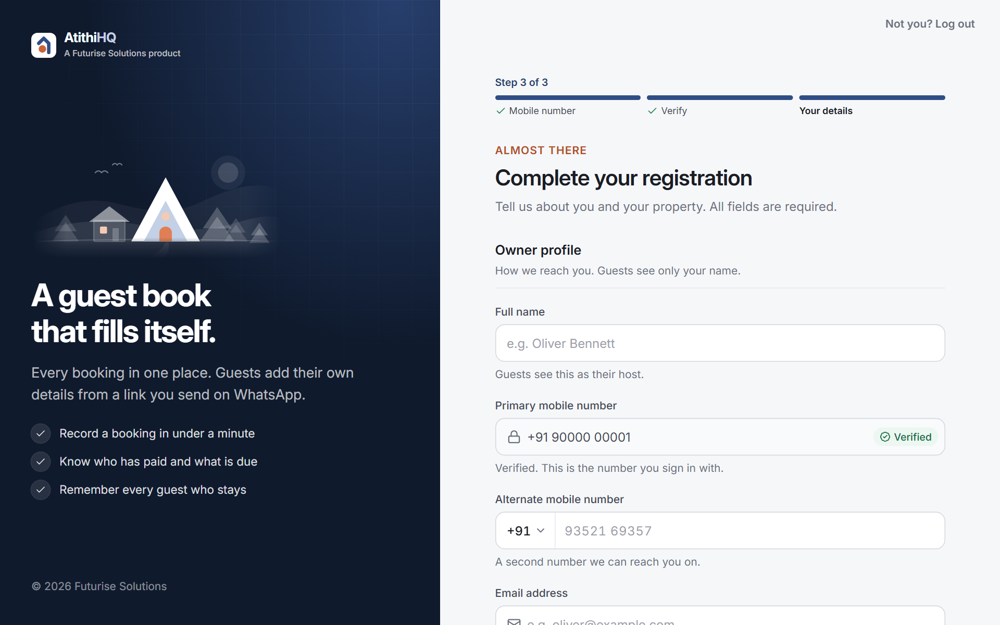<br/><sub><b>Registration</b> — owner, property, rooms and GST in one form</sub></td>
    <td>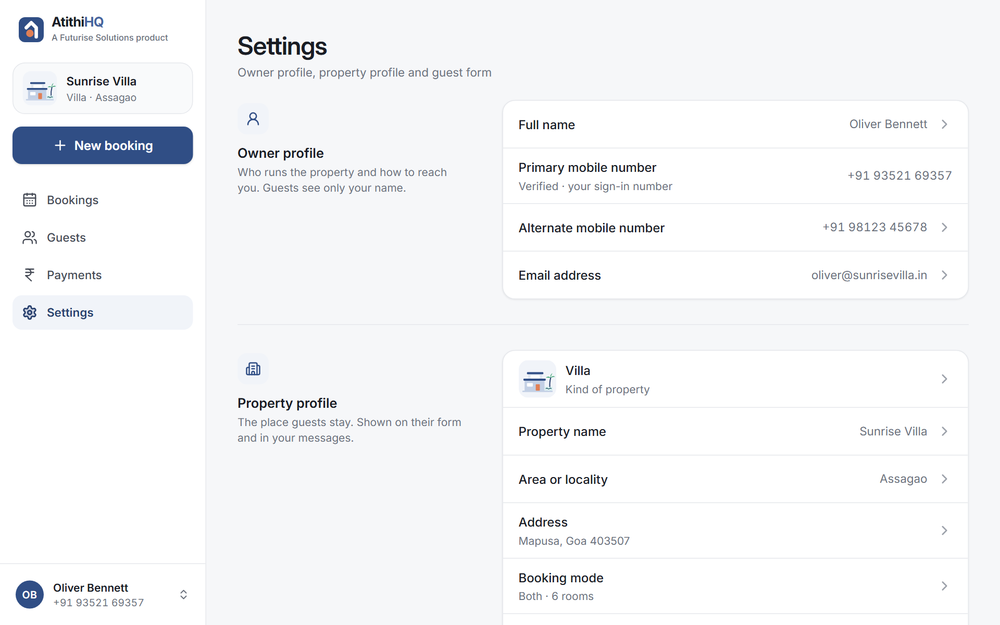<br/><sub><b>Settings</b> — owner profile, property and guest form rules</sub></td>
  </tr>
</table>

### On a phone

<table>
  <tr>
    <td align="center" width="25%">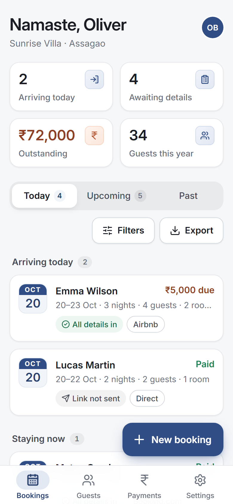<br/><sub><b>Owner</b> · bookings</sub></td>
    <td align="center" width="25%">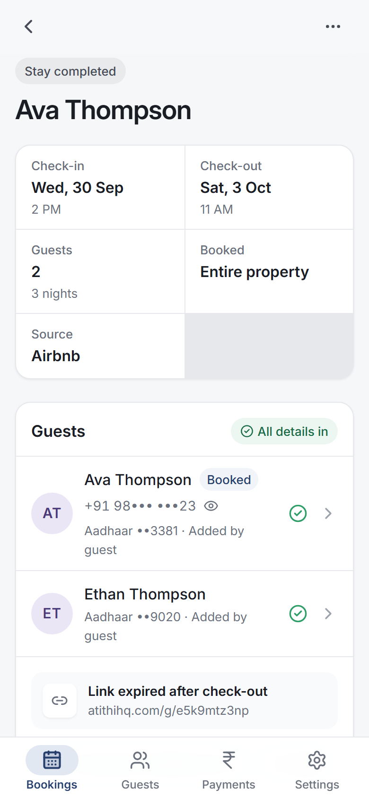<br/><sub><b>Owner</b> · booking</sub></td>
    <td align="center" width="25%">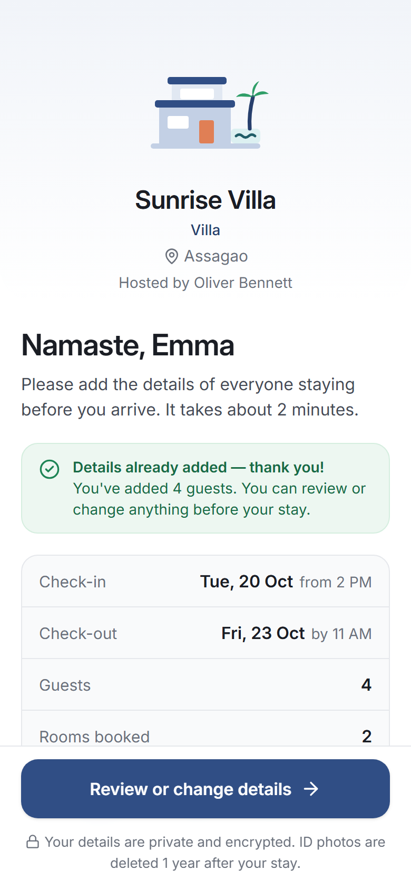<br/><sub><b>Guest</b> · the WhatsApp link</sub></td>
    <td align="center" width="25%">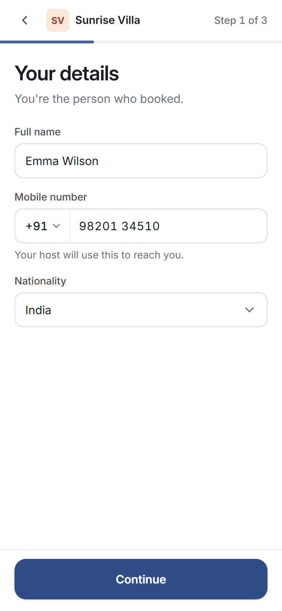<br/><sub><b>Guest</b> · their details</sub></td>
  </tr>
  <tr>
    <td align="center">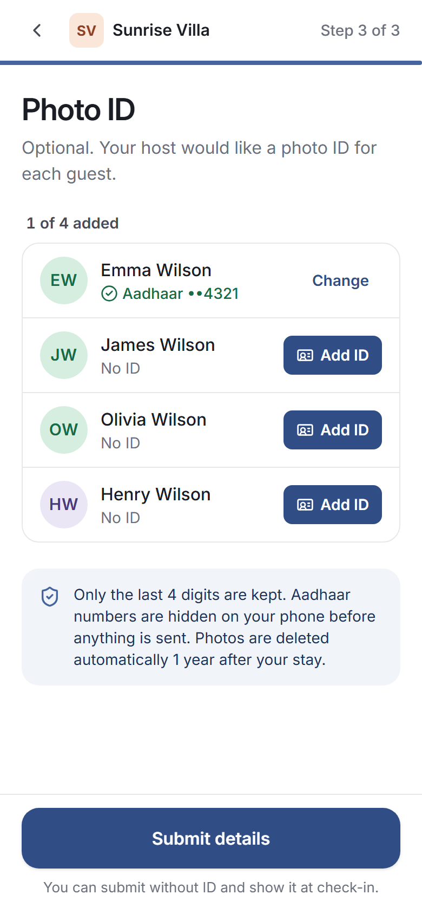<br/><sub><b>Guest</b> · photo ID, last 4 digits only</sub></td>
    <td align="center">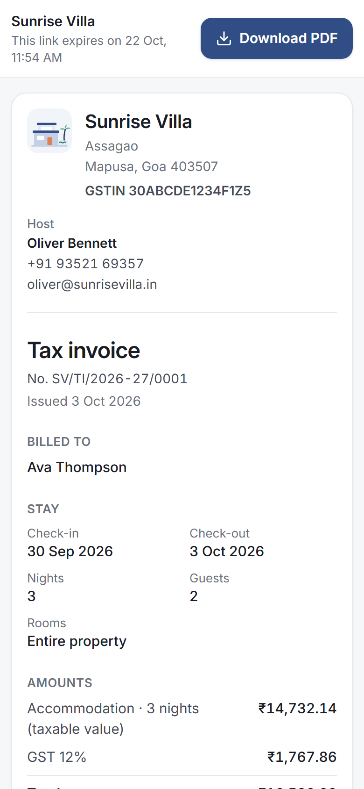<br/><sub><b>Guest</b> · the shared invoice</sub></td>
    <td colspan="2"></td>
  </tr>
</table>

## Try it locally

```bash
npm install
npx next dev -p 3100        # http://localhost:3100
```

| To see                      | Do this                                                                                       |
| --------------------------- | --------------------------------------------------------------------------------------------- |
| A property with sample data | Sign in with **93521 69357**                                                                  |
| A brand new account         | Sign in with any other mobile number, then complete registration                              |
| The verification code       | Any 6 digits work; `000000` shows the wrong-code error                                        |
| The guest form              | Open `/g/q7k2mxa4pr`                                                                          |
| A shared tax invoice        | `/r/rcpdemo7k2m` (valid) and `/r/rcpold9x3q` (expired)                                        |
| A fresh start               | **Log out → reset the demo** (demo number) or **delete this test account** (any other number) |

Set `NEXT_PUBLIC_SITE_URL` (default `https://atithihq.com`) to the deployed address. It is used for canonical
URLs, the sitemap and structured data. Guest and invoice links use the address the app is opened on.

| Script                | What it does                                 |
| --------------------- | -------------------------------------------- |
| `npm run dev`         | Dev server (Turbopack)                       |
| `npm run build`       | Production build                             |
| `npm run typecheck`   | TypeScript, no emit                          |
| `npm run lint`        | ESLint                                       |
| `npm run format`      | Prettier (also sorts Tailwind classes)       |
| `npm run screenshots` | Visual QA at phone / tablet / desktop sizes  |
| `npm run a11y`        | WCAG 2.1 AA audit (axe) of the main screens  |
| `npm run brand`       | Regenerate the favicon and home-screen icons |

## Tech stack

| Area          | Choice                                                                          |
| ------------- | ------------------------------------------------------------------------------- |
| Framework     | Next.js 16 (App Router, Turbopack), React 19 with the React Compiler            |
| Language      | TypeScript, strict                                                              |
| Styling       | Tailwind CSS v4 with design tokens, a named type scale and `cva` variants       |
| Data          | TanStack Query over a typed API contract                                        |
| Forms         | react-hook-form and zod                                                         |
| UI primitives | Radix UI, vaul (bottom sheets), react-day-picker, sonner (toasts), lucide icons |
| Documents     | html-to-image and jsPDF, loaded on demand; write-excel-file for exports         |
| Quality       | ESLint, Prettier, Playwright and axe-core                                       |

## Architecture

```
src/
  app/                 Routes only. Each page is a thin wrapper around a feature screen.
    page.tsx           / — the public home page
    (auth)/            /login, /register, /setup
    (owner)/           Signed-in owner screens, wrapped in the app shell
    (guest)/           /g/[token] the guest form · /r/[token] a shared invoice (no login, the link is the credential)
    (legal)/           Terms and privacy
    robots.ts  sitemap.ts  manifest.ts  llms.txt/  opengraph-image.tsx   search and sharing
  features/            One folder per product area: screens, feature components, data hooks
    home/ auth/ onboarding/ bookings/ guests/ payments/ invoices/ settings/ guest-form/ guest-details/ property/
  components/
    ui/                Design-system primitives (Button, Card/surfaceStyles, Field, Sheet, Badge…)
    layout/            App shell, navigation, page headers, sticky footer
    brand/             Logo (`mark.ts` is the single source of its shape), property illustrations
    seo/               JSON-LD script tag
  config/              site.ts (name, URL, locale) · routes.ts (every URL) · theme.ts (brand colours outside CSS)
  domain/              Types and pure business rules. No React, no I/O.
  lib/
    api/               The API contract (`contract.ts`), query keys, the `api` instance
    mock/              Mock backend: localStorage-backed store, seed data, mock API
    seo/               Page metadata helpers and structured data (schema.org)
    dates.ts money.ts phone.ts validation.ts …
  content/en/          Every user-facing string
docs/screenshots/      The images in this README
```

### Layers, from the bottom up

1. **`domain/`** holds the entities (`types.ts`), what screens read (`read-models.ts`) and the business rules:
   balance, guest-details status, stay phase, room availability, GST and invoice numbering. These are pure
   functions, so a backend can reuse them.
2. **`lib/api/contract.ts`** is the boundary between UI and backend. Screens never talk to the mock directly.
   They call `api.*` through TanStack Query hooks in `features/*/queries.ts`.
3. **`features/*`** renders screens with components from `components/ui`. Text comes from `useCopy()`, never
   hard-coded.

### Connecting the real backend

1. Implement `AtithiApi` (from `src/lib/api/contract.ts`) with HTTP calls.
2. Export it from `src/lib/api/index.ts` in place of `mockApi`, and set `demo.enabled = false`.
3. Replace the mock session cookie with the backend's httpOnly session cookie. `src/proxy.ts` already guards
   owner routes by that cookie name.
4. Remove `onExternalChange` (cross-tab refresh for the mock) from `src/lib/api/index.ts` and `app/providers.tsx`.

No screen or hook should need to change.

## Roadmap

- [x] Owner app: bookings, rooms, guests, payments, settings, registration
- [x] Guest form on a WhatsApp link, with private photo ID handling
- [x] GST tax invoices and receipts, versioned corrections, WhatsApp sharing and PDF
- [ ] Backend and database behind the existing API contract
- [ ] Real OTP sign-in by SMS
- [ ] ID photo storage with automatic deletion on the server
- [ ] Hindi interface (`src/content/hi/`)

<details>
<summary><b>Conventions for contributors</b></summary>

<br/>

- **Copy:** all text lives in `src/content/en/<area>.ts` and is read with `useCopy()`
  (or `getCopy()` outside React). Interpolated strings are functions. To add Hindi,
  add `src/content/hi/` with the same shape.
- **Design tokens:** colours, text styles, shadows and motion are defined in `src/app/globals.css`
  (`brand-*` navy, `accent-*` terracotta, `ink-*` text, `line`, `canvas`, `surface`,
  plus semantic `success`/`warning`/`danger`). Neutrals are cool and clean. Terracotta marks
  money due and warmth, and is never used for large backgrounds. Colours needed outside CSS
  (manifest, icons, social image) live in `src/config/theme.ts`.
- **Typography:** use the named type scale: `text-caption`, `text-footnote`, `text-subhead`,
  `text-callout`, `text-body`, `text-lead`, `text-headline`, `text-title-3/2/1`,
  `text-large-title` and `text-display*`. Each style carries its line height; titles also carry
  weight and letter-spacing. Tailwind's default sizes are switched off, and ESLint rejects
  pixel font sizes and raw hex colours in class names.
- **Surfaces:** anything card-like uses `surfaceStyles()` from `components/ui/card.tsx` (or `<Card>`),
  so every card changes together.
- **Buttons:** `<Button variant size>` from `components/ui/button.tsx`. Variants: primary, accent,
  secondary, soft, ghost, danger, danger-soft, link, and inverse (for navy surfaces). Buttons don't shrink, so
  put two full-width buttons side by side in a grid (`grid sm:grid-flow-col sm:auto-cols-fr`), not a flex row.
- **Links:** build URLs with `routes` from `src/config/routes.ts`, never by hand. To change one
  query parameter and keep the rest (tab, search, sort, filters), use `withParams` from `lib/url.ts`.
- **Guests list:** one row per booking (`features/guests/guest-groups.ts`). The row is named after
  the primary guest, the first person on the guest-details form. Everyone else whose details have
  arrived sits under "View all members (X)". X counts only those members, never the primary guest.
  The "Guests" column is the booking's party size, and repeat stays show "Returning · 2nd visit".
  Searching for a member opens their row and highlights them.
- **Guest details status:** the person who booked fills in everyone on one form, and every guest's
  name is required (phone and ID are optional). So the status follows the form:
  `Link not sent → Waiting for form → All details in` (`detailsState` in `domain/booking-rules.ts`).
  "N guests missing" appears only in the rare case where the form came back and the booking then
  gained guests.
- **Filters:** describe a screen's filters once as `FilterField[]` (see `features/*/…-filters.ts`).
  `useUrlFilters` keeps them in the URL, and `FilterButton` / `FilterChips` from
  `components/ui/filters.tsx` give the bottom sheet (phones), popover (tablet and up) and
  removable chips.
- **Export:** `ExportButton` opens a confirmation box. The owner chooses what to include (what's on
  screen, this month, last month or custom check-in dates) and the file type (Excel .xlsx by
  default, or CSV), sees how many rows will be exported, then downloads. Each screen's builder
  (`features/*/export.ts`) turns those rows into tables via `defineTable`. Import `@/lib/export` and the builder
  lazily, inside the click handler, so the spreadsheet library never lands in the initial bundle. Phone numbers
  are exported in full. **Identity-document data (numbers, last digits, type, photos, status) is
  never exported.**
- **Phone numbers** are masked in lists (`+91 98••• •••10`). Use `PhoneReveal` to let the owner
  reveal, call and copy a number; it hides itself again after 30 seconds. Never build a reveal
  for identity documents.
- **Registration:** "Get started" → `/register` (the sign-in screen in `register` mode: same mobile and code
  steps) → `/setup` (registration form: owner profile, property basics, consent) → dashboard. The rules and the
  `registrationStatus(session)` used by every guard live in `domain/registration.ts`; the form schema only adds
  messages. The OTP is mocked in `lib/mock/mock-api.ts` (any 6 digits, `000000` fails) and the UI says so while
  `demo.enabled`. Terms and Privacy pages are draft placeholders (`content/en/legal.ts`); replace them and bump
  `TERMS_VERSION` before launch.
- **Log out:** one `LogoutDialog` everywhere (account menu, Settings, the registration form). While
  `demo.enabled` it also offers to reset the demo or delete a test account, so a number can be tested again
  from scratch.
- **Owner vs property profile:** two separate concepts (`domain/profiles.ts`). The owner profile holds who runs
  the place and how to reach them (name, verified sign-in number, alternate number, email). The property profile
  holds the place itself: kind, name, locality, city/state/PIN, check-in/out. Never put owner contact details on
  the property or the property address on the owner. Screens read `ownerProfileOf` / `propertyProfileOf`.
- **Property types:** `domain/property-types.ts` (homestay, villa, guest house / B&B, cottage / farm stay, hostel).
  Each has an illustration in `components/brand/property-illustration.tsx`, shown on the sidebar card, in Settings,
  in registration and on the guest link. Pick with `PropertyTypePicker` (`features/property/`). To add a type,
  append its id; TypeScript then asks for its copy and illustration.
- **Booking mode and room inventory:** `domain/inventory.ts`. A property is rented as `entire`, `rooms` or
  `both`; room-based modes store `roomCount`, a **quantity** (`entire` stores `null`). Rooms are never named,
  numbered or assigned to guests: don't add room lists, IDs or room-name chips anywhere. Configure with
  `BookingModeFields` + `InventorySummary` (`features/property/`), in registration and Settings → Booking mode.
- **Availability:** `domain/availability.ts` (pure, backend-ready). A booking stores `roomsBooked` (a quantity, or
  `null` for the whole property). `availabilityFor` returns total / booked (busiest night) / remaining rooms and
  whether a whole-property booking fits; `checkRoomRequest` says why a request doesn't. Check-out day is free for a
  new check-in; cancelled bookings release their rooms. The booking form, the mock API (create, edit, restore) and
  the Settings guard (`inventoryInUse`) all use it. Whole-property-only properties keep the old behaviour (overlap
  warning, no block). Guests see only the quantity ("Rooms booked: 3"), never which rooms.
- **GST details:** `domain/gst.ts`. Optional: a property is not GST registered (`gst: null`, the default) or has
  `{ gstin, rate }`. The GSTIN is only a format check (exactly 15 letters and digits, after trimming, removing
  spaces and upper-casing; no state-code or checksum check), and the rate must be 5, 12 or 18 with no default.
  Configure with `GstFields` (`features/property/`), in registration and Settings → GST.
- **Receipts and tax invoices:** `domain/invoice.ts` (pure rules; the header comment has them all) and
  `features/invoices/`. Not GST registered: a receipt. GST registered: a tax invoice (GSTIN, one "GST 12%" line,
  included or added on top, worked in integer paise) or a payment receipt without GST. Numbers are per property
  and Indian financial year (`SV/2026-27/0001`; tax invoices `SV/TI/2026-27/0001`) and are assigned by the API on
  issue. An issued document is a snapshot and is never edited. To change it, the owner issues a new version with a
  reason ("Correct this invoice", or "Issue updated receipt" when the booking changed): the same number marked
  "Revised · v2", or a new number when switching between a tax invoice and a payment receipt. The reason is kept
  for the owner only and is never printed. Cancelled bookings can't get new documents.
- **Sharing invoices:** "Send on WhatsApp" makes a fresh public link each time (`invoices.share`), opens the lead
  guest's chat with a prefilled message, and the link expires after 48 hours (`RECEIPT_LINK_HOURS`). It opens
  `/r/[token]` (public, `noindex`, no AtithiHQ branding): the document, a notice if a newer version exists, or a
  friendly "expired" / "not valid" page. **PDF:** generated in the browser by `features/invoices/pdf.ts` from an
  off-screen copy rendered at 794px (A4), so it looks the same on every device; `InvoiceDocument` therefore uses
  container queries (`@xl:`), not viewport ones.
- **Mock data:** `lib/mock/store.ts` saves every tenant to localStorage (`atithi.mock-store.v1`). Each API call
  loads the latest save, does its work and saves again in one synchronous step, so tabs never overwrite each
  other; other tabs refresh through `onExternalChange`. The demo is seeded once relative to that day and is never
  wiped automatically.
- **Icons:** lucide line icons. Frame an icon with `IconTile` (`components/ui/icon-tile.tsx`, tones brand /
  accent / success / solid / glass) and spread `duotone` onto an icon for the soft filled look (active nav
  items, home page). Don't hand-roll icon chips.
- **Platform logos:** `public/logos/*.svg`, shown in the home page's sources marquee (`bands.tsx`).
  MakeMyTrip, Agoda and Goibibo are from Wikimedia Commons; the rest were generated from the Simple Icons set
  in brand colour. They are third-party trademarks, used only to say where bookings come from.
- **Loading:** `BrandLoader` (`components/brand/brand-loader.tsx`) is the full-screen loader, used by
  `Splash` and `app/loading.tsx`: the roof draws, a guest drops in, four dots light up as the group's details
  arrive. Buttons keep the small `Spinner`.
- **Illustration stories:** wrap a home page illustration in `<StoryLoop>` and its moving parts in `<Replay>`
  (`features/home/components/story-loop.tsx`). Stagger with `animation-delay`; the story restarts each time it
  scrolls into view and stays still with reduced motion.
- **Logo motion:** `<LogoMark motion="drop" />` loops the guest dropping in (loading); `motion="hop"` hops it
  when a parent with `group/logo` is hovered.
- **Brand:** the logo mark is defined once in `components/brand/mark.ts`. After changing it, run
  `npm run brand` to regenerate the favicon and home-screen icons. The social image
  (`app/opengraph-image.tsx`) is built from the same mark and the home page copy.
- **SEO:** public pages use `publicPageMetadata()` from `lib/seo/metadata.ts`; owner areas, guest links and shared
  invoices are `noindex`. The home page publishes Organization, WebSite, WebApplication, HowTo and FAQPage
  structured data built from `content/en/home.ts`, and `/llms.txt` summarises the product for AI assistants. Edit
  the copy and all of these follow.
- **Motion:** home page only, and subtle: one-time entrance animations and CSS scroll reveals
  (`reveal`). Everything is switched off for people who prefer reduced motion.
- **Status colours mean one thing everywhere.** Use `features/bookings/status.ts` for
  how a booking's guest-details and payment states look.
- **Overlays:** use `Sheet` for any focused task. It renders as a bottom sheet on phones and a
  centred dialog from tablet up. Use `ConfirmDialog` before anything destructive, `DocumentModal` for reading a
  document, and `ActionMenu` for overflow actions.
- **Forms:** react-hook-form + zod. Use shared validators from `lib/validation.ts` and
  wrap every control in `Field`, which wires up the label, hint, error and ARIA.
- **Responsive:** mobile first.
  - Phones (< 768px): bottom tab bar.
  - Tablets (768–1023px): navigation rail.
  - Desktop (≥ 1024px): sidebar.
  - Lists become grouped rows from `md`, and detail pages split into two columns at `lg`.
- **Touch targets** are at least 44px and body text is 16px. Never rely on colour alone:
  badges carry text and icons.
- **Money** is whole rupees, formatted with `formatINR` (Indian grouping); invoices work in integer paise.
  **Phones** are stored as E.164 strings (`+919352169357`).
  **Dates** are `YYYY-MM-DD` strings.

</details>

---

<div align="center">
<sub><b>AtithiHQ</b> · A <a href="https://futurisesolutions.com">Futurise Solutions</a> product</sub>
</div>
